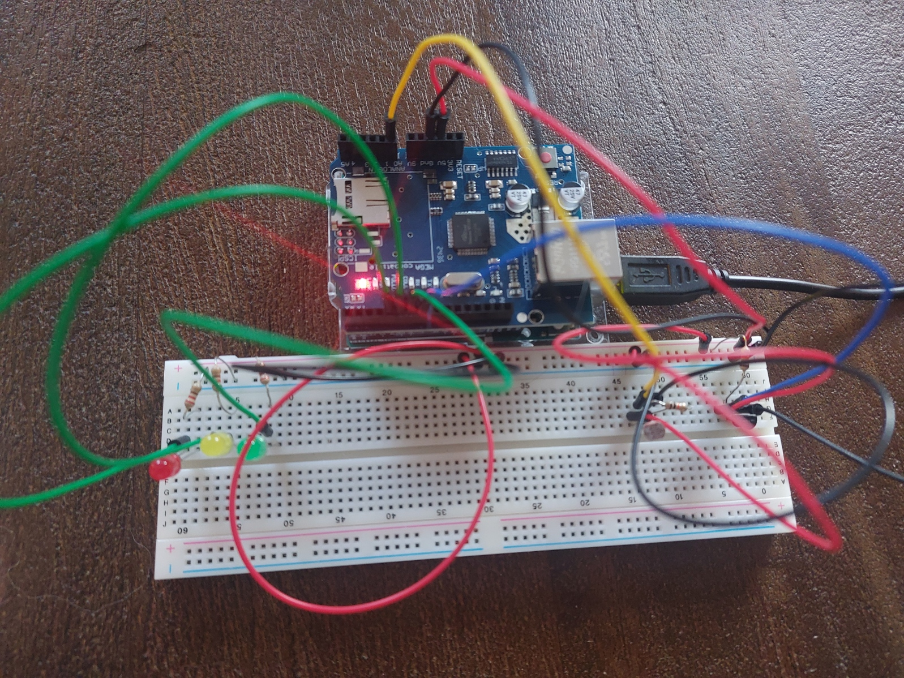

# AVR Environmental Monitor

Bare-metal C firmware for an environmental monitoring system.

The project focuses on embedded software fundamentals: peripheral drivers, interrupt-driven communication, sensor acquisition, state-machine design, and reusable hardware-independent modules. It uses direct AVR register access instead of the Arduino framework or Arduino libraries.

**Status:** Work in progress.

## Roadmap

The roadmap focuses on gaining practical experience with bare-metal C and exploring additional embedded software techniques.

- [ ] **Hardware schematic:** Create a KiCad schematic documenting the Arduino Uno, sensors, wiring, and hardware connections.
- [ ] **LCD interface:** Add a Waveshare LCD module to display temperature and light levels, including visual indicators for ambient brightness.
- [ ] **Communication interfaces:** Add Ethernet connectivity using an Arduino Ethernet Shield alongside the existing UART interface.
- [ ] **Configurable communication:** Allow the communication interface and message protocol to be selected through configuration.
- [ ] **PC dashboard:** Develop a C#/.NET desktop application to display live sensor measurements received over UART or Ethernet.
- [ ] **Measurement statistics:** Calculate average, minimum, and maximum values, as well as measurement counts, over a selected time period.
- [ ] **Data visualization:** Display historical temperature and light-level measurements in graphs and allow users to explore measurement trends.
- [ ] **Data storage:** Store measurements locally so historical data and statistics remain available after restarting the dashboard.
- [ ] **Measurement history buffer:** Implement a fixed-size buffer in the firmware to retain recent sensor measurements.
- [ ] **Testing and debugging:** Expand host-side unit tests and use a logic analyzer to investigate communication, timing, and hardware behavior.
- [ ] **Portability:** Evaluate how the firmware architecture could be adapted to another microcontroller.

## Features

- **Temperature measurement** using a DS18B20 digital temperature sensor over the 1-Wire protocol.
- **Light-level measurement** using an LDR connected to the AVR's 10-bit ADC.
- **Asynchronous measurement flow** coordinated by a state machine and a millisecond system timer.
- **UART communication** using a transmit ring buffer and interrupt-driven transmission.
- **Sensor data validation** using Dallas/Maxim CRC-8 for DS18B20 scratchpad data.
- **Error handling** for sensor communication failures, invalid data, and repeated measurement errors.
- **Fixed-memory design** using statically allocated buffers instead of dynamic memory allocation.
- **Host-side unit tests** for hardware-independent modules.

## Technologies

- **Language:** C (bare-metal AVR)
- **Microcontroller:** ATmega328P
- **Build system:** CMake and Ninja
- **Testing:** Host-side unit tests
- **Hardware debugging:** Logic analyzer
- **Planned:** KiCad, C#/.NET, Ethernet, SPI display driver

## Hardware

| Component | Connection |
|---|---|
| Arduino Uno (ATmega328P, 16 MHz) | USB connection to the development PC |
| DS18B20 temperature sensor | 1-Wire data on digital pin 7 (PD7) |
| LDR and 10 kΩ resistor | Voltage divider connected to analog input A0 |
| LCD module | Planned — Waveshare LCD |
| UART | 9600 baud over the USB serial connection |

The 1-Wire bus requires a suitable pull-up resistor, typically 4.7 kΩ to 5 V.


*Current prototype of the AVR Environmental Monitor.*

## Architecture

The firmware is organized into separate modules with clear responsibilities.

| Module | Responsibility |
|---|---|
| `envmon_machine` | Coordinates application states, measurements, and error handling |
| `sensor_manager` | Coordinates sensor acquisition and measurement timing |
| `ds18b20` | Reads temperature data and validates the sensor scratchpad |
| `onewire` | Implements low-level 1-Wire bus communication |
| `adc` | Configures and reads the AVR analog-to-digital converter |
| `protocol` | Formats measurement and error messages |
| `serial` | Provides buffered UART transmission |
| `circularbuffer` | Provides a reusable, statically backed circular buffer |
| `timer` | Maintains a millisecond counter using a hardware timer interrupt |
| `power` | Provides idle sleep functionality |
| `platform` | Initializes platform peripherals |
| `crc8` | Implements the Dallas/Maxim CRC-8 algorithm |

Hardware-specific code is kept separate from application logic where practical, making the core easier to test and potentially port to another microcontroller.

## Communication Protocol

The firmware sends human-readable text messages over UART. Each message is terminated with CRLF (`\r\n`).

### Measurement Message

```text
V1,DATA,TEMP=23.5,LIGHT=612
```

- `V1` identifies protocol version 1.
- `DATA` identifies a sensor measurement.
- `TEMP` is temperature in degrees Celsius.
- `LIGHT` is the raw ADC reading, ranging from 0 to 1023 on the current 10-bit ADC.

### Error Message

```text
V1,ERR,SENSOR
```

This indicates a sensor-related error. The current protocol does not yet include detailed error codes.

**Serial settings:** 9600 baud, 8 data bits, no parity, 2 stop bits (8N2).

The protocol module is responsible for formatting messages; the serial driver handles transmission.

## Building and Flashing

### Requirements

- AVR 8-bit GNU toolchain (`avr-gcc` and related tools)
- `avrdude`
- CMake
- Ninja

Make sure these tools are available on your `PATH`.

### Build the Firmware

From the firmware project directory, run the following in PowerShell:

```powershell
cmake -S . -B build_avr -G Ninja `
  -DBUILD_FIRMWARE=ON `
  -DBUILD_TESTS=OFF `
  -DBOARD=uno `
  "-DCMAKE_TOOLCHAIN_FILE=$((Resolve-Path .\cmake\avr-toolchain.cmake).Path)"

cmake --build build_avr
```

### Flash the Arduino Uno

```powershell
cmake --build build_avr --target upload
```

The upload target uses the serial port configured in the project's CMake configuration. Update that setting if your Arduino is connected to a different port, and close any serial terminal before uploading.

### Run Host-Side Tests

Hardware-independent modules can be tested on the development PC without flashing the microcontroller.

```powershell
cmake -S . -B build_tests -G Ninja `
  -DBUILD_FIRMWARE=OFF `
  -DBUILD_TESTS=ON

cmake --build build_tests
ctest --test-dir build_tests --output-on-failure
```

## Design Decisions

### Static Memory Allocation

The firmware avoids `malloc` and uses statically allocated storage wherever practical. This keeps memory usage predictable on the ATmega328P, which has only 2 KB of SRAM.

### Interrupt-Driven UART Transmission

Application code queues outgoing bytes in a transmit buffer. The UART data-register-empty interrupt sends bytes as the hardware becomes ready, keeping transmission work out of the main application flow.

The buffer rejects a message if there is insufficient space rather than deliberately queueing a partial message.

### Short Interrupt Handlers

Interrupt service routines perform only time-critical work, such as updating the system tick or sending the next queued byte. Sensor coordination and message formatting happen outside the interrupt handlers.

### State-Machine-Based Application Flow

The application uses explicit states for idle operation, measurement, and error handling. Sensor conversion timing is managed using the system timer instead of blocking the main loop while waiting for a conversion to finish.

The low-level 1-Wire driver still uses short timing delays where required by the protocol.

### Reusable Modules and Testability

Hardware-independent code is separated from AVR-specific drivers. Modules such as the CRC implementation, circular buffer, and protocol formatter can be tested independently of the target hardware.

## Project Goals

The primary goal of this project is to gain practical experience with bare-metal C programming and explore embedded software techniques beyond the Arduino framework.

Additional hardware and software features will be introduced incrementally as opportunities to explore new concepts.

The emphasis is on understanding how the underlying systems work, writing maintainable firmware, and expanding practical embedded software skills.